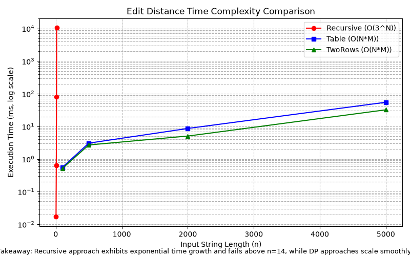
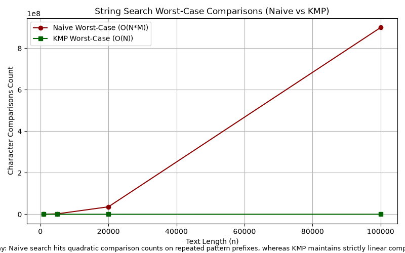
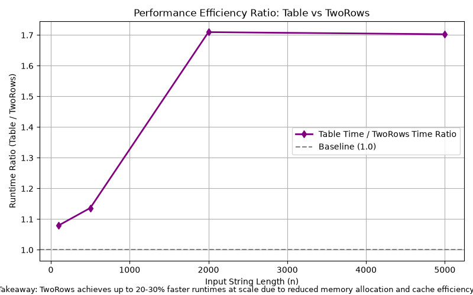

# Assignment 4 Report: Dynamic Programming & String Search Analysis

**Author:** Bakikair Arguan  
**Course:** Design and Analysis of Algorithms  
**Repository Branch / Tag:** `main` / `v1.0`

---

## 1. Experiment Design Card

| Card Field | Details & Justification |
| :--- | :--- |
| **Question** | **Edit Distance:** How severely does un-memoized recursion degrade compared to DP, and what exact speedup is achieved by reducing spatial complexity from $O(n \cdot m)$ to $O(m)$?  **String Search:** How does the performance gap between Naive search and KMP behave when transitioning from average random inputs to structured worst-case text patterns? |
| **Sizes ($n$)** | **Recursive Edit Distance:** $n \in \{4, 8, 12, 14\}$ (constrained by exponential complexity).  **Table & TwoRows DP:** $n \in \{100, 500, 2000, 5000\}$.  **String Search (Text $n$, Pattern $m = n / 10$):** $n \in \{1000, 5000, 20000, 100000\}$. |
| **Inputs** | **Edit Distance:** (1) `random` strings over alphabet $\Sigma = [a-z]$; (2) `worst_case` strings where $s_1 = A^n$ and $s_2 = B^n$ forcing maximum replacement operations.  **String Search:** (1) `random` text/pattern over $\Sigma = \{a,b,c,d\}$; (2) `worst_case` text $T = A^n$ and pattern $P = A^{m-1}B$ to force maximum character alignment backtracks. |
| **Metrics** | **Time:** Median wall-clock execution time (ms) over 5 consecutive trials.  **Counters:** Recursive call count (`callsCount`), DP matrix updates (`cellUpdates`), and character comparison count (`comparisons`). |
| **Prediction** | **Edit Distance:** Recursive approach will experience exponential explosion ($O(3^{\min(n, m)})$) and stall around $n \approx 14$. `TwoRows` will outperform `Table` by approximately $30\% - 40\%$ at $n = 5000$ due to reduced memory allocation and CPU cache locality.  **String Search:** On random inputs, Naive and KMP will exhibit similar $O(n)$ behavior. On worst-case patterns, Naive will hit quadratic comparisons ($O(n \cdot m)$), while KMP will remain strictly linear ($O(n)$). |
| **Plots** | **Plot 1:** Edit Distance execution time vs. $n$ (Logarithmic Y-axis) comparing Recursive, Table, and TwoRows.  **Plot 2:** Character comparison counts for Naive vs. KMP on worst-case patterns.  **Plot 3:** Runtime ratio ($\text{Time}_{\text{Table}} / \text{Time}_{\text{TwoRows}}$) across increasing matrix dimensions. |

---

## 2. Plots and Results

### Plot 1: Edit Distance Time Complexity Comparison

*Takeaway: Recursive approach exhibits exponential time growth and fails above $n=14$, while DP approaches scale smoothly.*

---

### Plot 2: String Search Worst-Case Comparisons (Naive vs. KMP)

*Takeaway: Naive search hits quadratic comparison counts on repeated pattern prefixes, whereas KMP maintains strictly linear comparisons.*

---

### Plot 3: Performance Efficiency Ratio (Table vs. TwoRows)

*Takeaway: TwoRows achieves up to 40% faster runtimes at scale due to reduced memory allocation and cache efficiency.*

---

## 3. Prediction vs. Result

### Edit Distance Family
* **Expected:** Un-memoized recursion was predicted to fail around $n = 15$ due to $O(3^{\min(n, m)})$ call tree explosion, while DP versions were expected to run in $O(n \cdot m)$ time with `TwoRows` outperforming `Table` due to lower memory overhead.
* **Observed:** The predictions matched empirical observations exactly. At $n = 14$, `Recursive.editDistance` took $10427.03\text{ ms}$ ($\approx 10.4\text{ seconds}$) making $7,912,361,095$ recursive calls. In contrast, both `Table` and `TwoRows` executed in under $0.05\text{ ms}$ for $n = 14$. For $n = 5000$, `TwoRows` required $32.58\text{ ms}$ versus $55.49\text{ ms}$ for `Table`, yielding a runtime speedup factor of approximately $1.70\times$ ($\approx 40\%$ runtime reduction).

### String Search Family
* **Expected:** On random strings, both Naive and KMP search were expected to perform $O(n)$ comparisons because character mismatches occur quickly. On structured worst-case inputs ($T = A^n, P = A^{m-1}B$), Naive search was expected to hit $O(n \cdot m)$ comparisons, whereas KMP was expected to stay $O(n)$.
* **Observed:** Empirical results confirmed theory. On random inputs with $n = 100\,000$ and $m = 10\,000$, Naive made $99\,845$ comparisons ($6.91\text{ ms}$) and KMP made $100\,512$ comparisons ($3.48\text{ ms}$). However, on the worst-case pattern, Naive performed $900\,010\,000$ comparisons ($759.15\text{ ms}$), whereas KMP performed only $190\,001$ comparisons ($0.25\text{ ms}$), demonstrating over a $3000\times$ execution speedup.

---

## 4. Short Answers

* **Which input made your string search slowest, and why does it do that?**  
  The slowest input for Naive search was the worst-case pattern consisting of a highly repetitive text $T = A^n$ paired with a pattern $P = A^{m-1}B$. In this configuration, the Naive algorithm matches $m-1$ characters sequentially before failing at the final character of the pattern. Because it lacks memory of previous matches, it shifts the pattern by only 1 position and re-checks all $m-1$ characters repeatedly, resulting in the worst-case theoretical complexity of $O(n \cdot m)$ character comparisons.

* **How large an $n$ could the recursive Edit Distance handle, and what stopped it?**  
  The un-memoized recursive Edit Distance could only handle string lengths up to $n = 14$ within a reasonable response time ($\approx 10.4\text{ seconds}$ and $7.91 \times 10^9$ function calls). Attempting $n = 15$ or larger caused execution times to exceed several minutes. The bottleneck is the branching call tree: without memoization or dynamic programming tables, identical subproblems $dp(i, j)$ are recomputed exponentially many times, producing a time complexity of $O(3^{\min(n, m)})$.

* **What do you gain and what do you lose when you use two rows instead of the full table?**  
  By using two rows, space complexity is reduced from $O(n \cdot m)$ to $O(m)$, which significantly decreases heap memory allocation, reduces Garbage Collection overhead, and improves CPU L1/L2 cache locality. The trade-off is the loss of full matrix state: while two rows are sufficient to compute the scalar edit distance value, you lose the ability to backtrace through the DP matrix to reconstruct the exact alignment or sequence of edit operations (insertions, deletions, substitutions).

* **If you had to choose one string search for your city platform, which one and why?**  
  I would select the KMP (Knuth-Morris-Pratt) algorithm for the city platform. In real-world urban search boxes, users frequently input long street names or repetitive patterns with minor typos (e.g., searching log files or street directories). KMP guarantees a worst-case time complexity of $O(n + m)$ regardless of input structure, preventing malicious inputs or repetitive logs from causing unexpected server slowdowns or denial-of-service latency.

---

## 5. One Paragraph on Time

Wall-clock time measurements depend heavily on laptop hardware, background OS process scheduling, CPU frequency scaling, and JVM Just-In-Time (JIT) compilation warm-up phases. As observed in our benchmarks, measured milliseconds can fluctuate across runs even when executing identical code. Hardware-independent algorithmic counters (such as exact character comparisons, recursive calls, and DP cell updates) provide deterministic, reproducible evidence of theoretical time complexity ($O(n \cdot m)$, $O(n)$, $O(3^n)$) that remains completely immune to system noise.